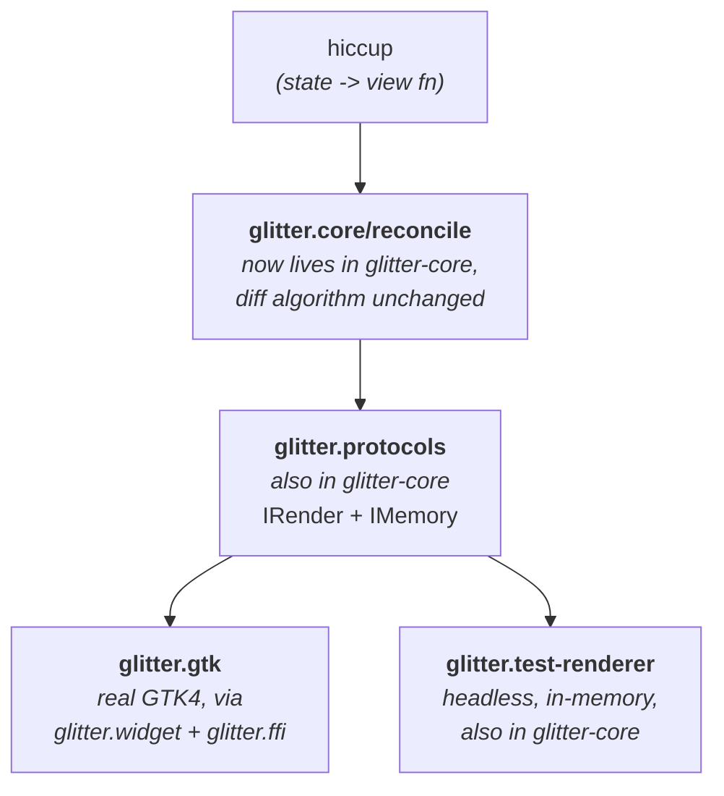

# glitter

A Replicant-style GTK4 renderer for [Jolt](https://github.com/jolt-lang/jolt).

Where [glimmer](https://github.com/jolt-lang/glimmer) applies
[Reagent](https://reagent-project.github.io/)'s model to GTK4 (ratoms,
automatic dependency tracking, component-local state), glitter applies
[Replicant](https://github.com/cjohansen/replicant)'s model: a single
application-state atom, a pure `state -> hiccup` view function, top-down
re-render on every state change, and data-driven action-dispatch event
handlers instead of closures. No component-local state anywhere.

**Documentation:** <https://jlt-commons.github.io/glitter/>

Requires jolt 0.8.24 or newer (declared as `:jolt/min-version` in `deps.edn`).

## Quick start

```clojure
(require '[glitter.app :as app]
         '[glitter.core :as core]
         '[glitter.gtk :as gtk])

(defonce state (atom {:count 0}))

(defn view [{:keys [count]}]
  [:box {:spacing 12}
   [:label {:label (str "Count: " count)}]
   [:button {:label "+ 1" :on {:click [[:action/inc]]}}]])

(core/set-dispatch!
 (fn [_event actions]
   (doseq [[kind] actions]
     (case kind :action/inc (swap! state update :count inc) nil))))

(app/run (fn [window] (gtk/mount! window view state)))
```

`jolt counter` is the minimal demo. `jolt todo` is a task board, and four more
are ports of [7GUIs](https://eugenkiss.github.io/7guis/) tasks: `jolt crud`,
`jolt flights` (Flight Booker), `jolt temperature` and `jolt timer`. All of them dispatch through `glitter.nexus`, a port of
[nexus](https://github.com/cjohansen/nexus) (same author as Replicant):
actions go to registered **effect** handlers (the only functions allowed to
mutate state), **placeholder** resolvers substitute event-derived values into
the action data, and **action-expansions** are pure
`(state & args) -> more-actions` functions for interactions that need the
current state first. [`docs/guide/nexus.md`](docs/guide/nexus.md) has the
full model. The code now lives in the separate `nexus-jolt` package as
`nexus.core` and `nexus.registry`.

Four widget galleries (`jolt gallery-inputs`, `gallery-layout`,
`gallery-display`, `gallery-chrome`) are runnable reference pages that
between them use all 43 widget tags.
[`docs/guide/widgets.md`](docs/guide/widgets.md) is the per-tag reference of
props, signals and what `[:glitter/value]` resolves to.
[`docs/guide/examples.md`](docs/guide/examples.md) lists every demo and
every live-GTK smoke.

`jolt test` runs the unit suite. The live-GTK smokes each mount a real
window and exit non-zero on failure. In CI, `jolt -M:test` and the other
`-M:<alias>` forms are the safe choice, and `bb smokes` runs every smoke in
sequence.

### Or via `bb`

If you have [Babashka](https://babashka.org/) installed, `bb.edn` wraps the
same tasks with a grouped cheat-sheet:

```
bb info      # start here: grouped task list
bb test      # jolt -M:test
bb counter   # interactive demo
bb todo      # interactive task-board demo
bb crud      # interactive 7GUIs CRUD demo
bb flights   # interactive 7GUIs Flight Booker demo
bb temperature # interactive 7GUIs Temperature Converter demo
bb timer     # interactive 7GUIs Timer demo
bb smokes    # every live-GTK smoke in sequence, CI-safe (stops at first failure)
```

`bb.edn`'s tasks all shell out to the `-M:<alias>` form directly (never the
deps.edn `jolt <task>` shorthand), so `bb test` and `bb smokes` exit non-zero
on failure and are safe to use as a CI check.

### Quality tooling

```
bb lint / lint:strict / lint:errors      # clj-kondo: report | propagate exit | errors-only
bb lsp:format / lsp:format-check          # reformat, or check formatting (dry run)
bb lsp:clean-ns / lsp:clean-ns-check      # organize ns forms, or check (dry run)
bb lsp:diagnostics / lsp:check / lsp:fix  # diagnostics | all dry-run checks | auto-fix
bb check:positional-args / :strict        # find fns with 3+ positional args
bb verify                                 # pre-commit check: lint (report) + test (must pass)
bb hooks:install / :install:full / :uninstall  # git pre-commit hook: fast | +tests | remove
bb site:build / site:serve [port] / site:clean # local preview of the docs site
```

clj-kondo and clojure-lsp need `.clj-kondo/hooks/jolt_ffi.clj`, an
`analyze-call` hook that rewrites `jolt.ffi/defcfn` into an equivalent `defn`
(adapted from [b12n-raylib-jlt](https://github.com/jlt-commons/raylib-jlt)).
Without it every `gtk-*`/`g-*` name in `glitter.ffi` reports as unresolved.
`.clj-kondo/config.edn` excludes the files ported verbatim from Replicant,
which keep `#?(:clj :cljs)` reader conditionals in a `.clj` extension. The
whole codebase is formatted uniformly, and the fast pre-commit hook blocks
any commit that isn't `bb lsp:format-check`-clean. See
[`docs/guide/testing-and-tasks.md`](docs/guide/testing-and-tasks.md).

## Architecture



`glitter.core` drives *when*: it diffs old hiccup against new and calls
`IRender`/`IMemory` methods. It has no idea GTK exists, which is what makes
two backends possible from one reconciler: real widgets for an app, an
in-memory fake for headless tests.

Where the code came from:

- `glitter.core`, `glitter.protocols`, `glitter.hiccup*`, `glitter.vdom`,
  `glitter.alias`, `glitter.errors`, `glitter.assert*`, `glitter.console-logger`,
  `glitter.env`, `glitter.test-renderer`, and the nexus action-log accumulator
  (`glitter.nexus.action-log`) now live in the
  [glitter-core](https://github.com/jlt-commons/glitter-core) dependency,
  which declares no `:jolt/native` at all. Originally ported from
  [Replicant](https://github.com/cjohansen/replicant) (MIT, Christian
  Johansen) and, for the action-log piece,
  [nexus](https://github.com/cjohansen/nexus) (MIT). See `glitter-core`'s
  own `NOTICE`.
- `glitter.nexus`/`glitter.nexus.registry` (now `nexus.core`/
  `nexus.registry`) moved to the standalone
  [nexus-jolt](https://github.com/jlt-commons/nexus-jolt) package, a
  plain Jolt port of upstream cjohansen/nexus.
- `glitter.ffi`, `glitter.widget`, `glitter.genum`: forked from
  [glimmer](https://github.com/jolt-lang/glimmer). `glitter.app` is adapted
  from the non-reactive app-loop part of `glimmer.core`.
- `glitter.gtk`: new code specific to glitter, unmoved. See `NOTICE`.

## Documentation

- [`docs/guide/index.md`](docs/guide/index.md): the full guide, covering the
  reconcile to `IRender`/`IMemory` architecture, GTK4 widget and signal
  mechanics, cross-thread marshalling, porting and attribution, testing, and
  known limitations.
- [`CONTRIBUTING.md`](CONTRIBUTING.md): setup, the checks to run before a PR,
  how to add a widget, and the numbered list of invariants not to regress.
- [`NOTICE`](NOTICE): file-by-file provenance for what is forked from glimmer
  and still lives here. The Replicant-ported reconciler and nexus-jolt have
  their own NOTICE files in `glitter-core` and `nexus-jolt`.

## Status

**Early.** 43 widget tags, plus `:hbox`/`:vbox` sugar for an oriented
`:box`. Nine came from the original fork of
[glimmer](https://github.com/jolt-lang/glimmer) and the rest were added in
glitter. This repo owns the GTK4 widget layer and depends on `glitter-core`
and `nexus-jolt` for the rest.

| Group | Tags |
|---|---|
| From the glimmer fork | `window` `box` `button` `label` `entry` `checkbutton` `separator` `frame` `scrolled` |
| Display-only | `:spinner` `:progress-bar` `:image` `:level-bar` `:picture` `:inscription` |
| Buttons and toggles | `:toggle-button` `:link-button` `:switch` `:menu-button` |
| Text entry | `:password-entry` `:search-entry` `:editable-label` `:search-bar` |
| Values and selection | `:scale` `:spin-button` `:scale-button` `:calendar` `:drop-down` |
| Containers | `:revealer` `:center-box` `:paned` `:overlay` `:aspect-frame` `:expander` `:window-handle` |
| Multi-child / layout | `:list-box` `:flow-box` `:grid` `:stack` `:notebook` |
| Chrome and popups | `:header-bar` `:action-bar` `:popover` |

Hiccup `:class` reaches real GTK CSS classes, so GTK4's built-ins (`"flat"`,
`"suggested-action"`, `"destructive-action"`, `"pill"`) work with no
app-provided CSS. `:style` does nothing, since GTK4 has no inline-style
equivalent, and there are no animated mount/unmount transitions yet.

Known limitations, such as `mount!` being one-way and several containers
not tolerating a tag swap in an occupied slot, are listed in
[`docs/guide/limitations.md`](docs/guide/limitations.md).

## Licence

Copyright (c) 2026 Burin Choomnuan.

glitter's own code is distributed under the [Eclipse Public License 2.0](LICENSE),
matching the rest of jlt-commons and jolt itself. SPDX identifier: `EPL-2.0`. It
was MIT until 2026-09-05.

That covers what was written here. The code forked from glimmer keeps the
licence it came with, and [`NOTICE`](NOTICE) is the file-by-file record of
what came from where for everything still vendored in this repo. The
Replicant-ported reconciler and nexus-jolt's own provenance moved along
with the code itself and are recorded in `glitter-core`'s and `nexus-jolt`'s own
NOTICE files. EPL 2.0 relicenses none of it: the whole is EPL 2.0 and
each part keeps what it came with, as long as those notices travel with it.
