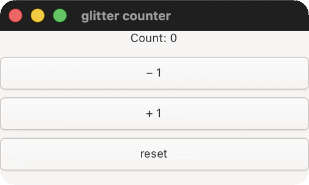
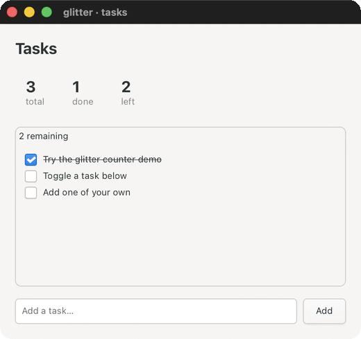
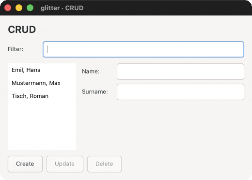
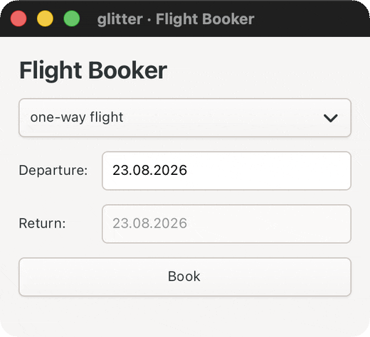
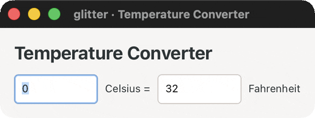
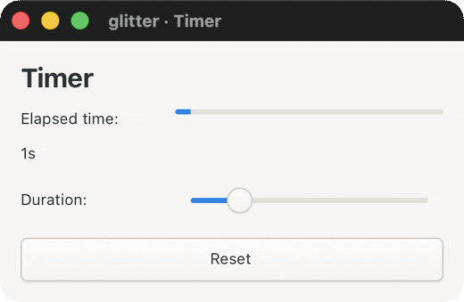
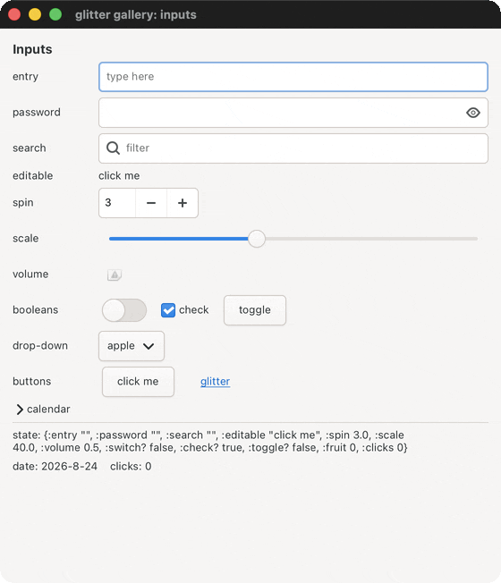
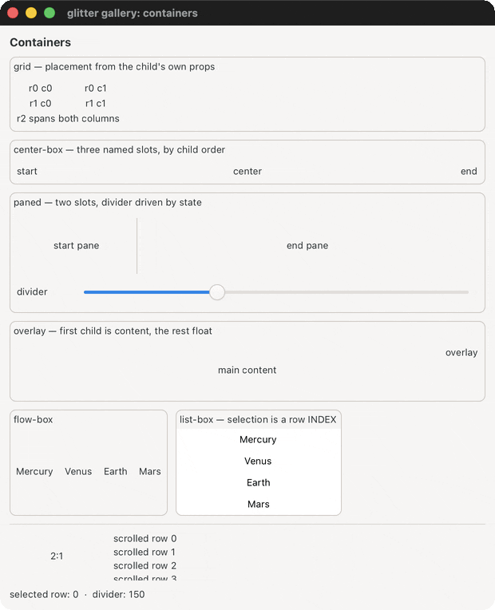
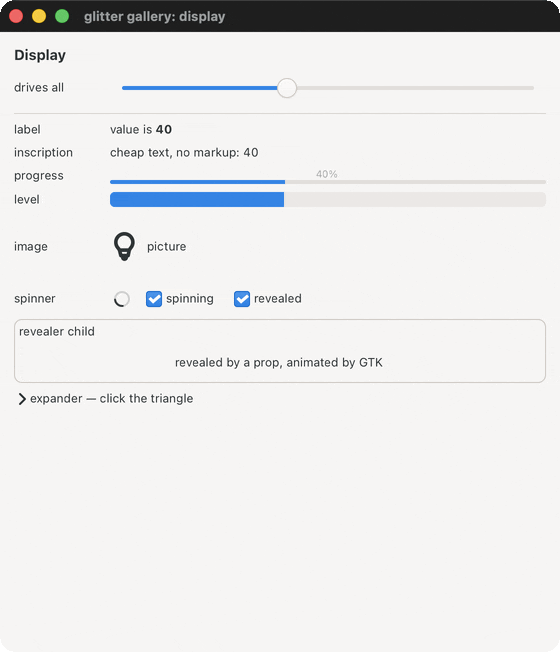
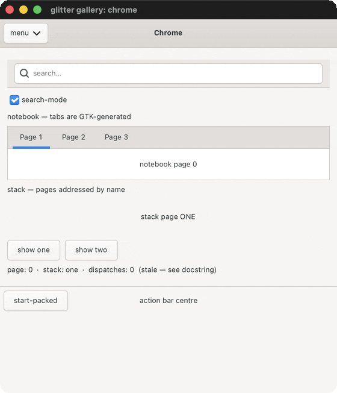

# The examples

Everything runnable lives under `examples/glitter/`, in three kinds.

- **Interactive demos** you open and click. Four of them are
  [7GUIs](https://eugenkiss.github.io/7guis/) tasks, so they can be
  compared against implementations in other toolkits.
- **Widget galleries**, reference pages you can run. Between them
  they use all 43 registered tags, and each is written to be copied from.
  [`widgets.md`](widgets.md) quotes them. Run `bb gallery-inputs`,
  `bb gallery-layout`, `bb gallery-display`, `bb gallery-chrome`.
- **Live-GTK smokes** that mount a real window, assert against
  real GTK state, and exit non-zero on failure. They are the regression
  suite for the GTK layer, which the headless unit suite can't reach.

Run any of them with `bb <name>`, or `jolt -M:<name>` without babashka.
`bb info` prints the same grouping live.

## Interactive demos

| preview | `bb` name | Task | What it demonstrates |
|---|---|---|---|
|  | `counter` | n/a | The canonical demo. One state atom, a pure `state -> hiccup` view, handlers as data. The 20-line version of the whole model. |
|  | `todo` | n/a | A task board: derived counts computed inline (glitter has no reactive-derivation primitive, the view just re-runs), an entry with `:change`/`:activate`, checkbutton toggles, list rendering in a frame. |
|  | `crud` | [CRUD](https://eugenkiss.github.io/7guis/tasks/#crud) | Live prefix filter, single-selection list box, name/surname fields, Create/Update/Delete. The spec's "separation of domain and presentation logic" is the pure `get-people` fn, shared by the view and the select-row expansion. |
|  | `flights` | [Flight Booker](https://eugenkiss.github.io/7guis/tasks/#flight-booker) | Constraints *between* widgets and *within* one. The first `glitter.nexus` consumer, and the only demo that needs no action expansions at all: every interaction is at most two effects. |
|  | `temperature` | [Temperature Converter](https://eugenkiss.github.io/7guis/tasks/#temp) | Two linked numeric fields, each updating the other. Needs exactly one action expansion, because which field is the *source* depends on which one you just edited. |
|  | `timer` | [Timer](https://eugenkiss.github.io/7guis/tasks/#timer) | The first demo whose state advances **on its own**: a background tick via a demo-local `:effect/schedule`, plus a Reset button. |

Previews are recordings committed under `docs/demos/`; each thumbnail links
to the full-size file.

## Widget galleries

Runnable reference pages. [`widgets.md`](widgets.md) quotes them per tag.

| preview | gallery |
|---|---|
|  | **`bb gallery-inputs`**: every value-bearing widget, all writing into one state atom, with a readout rendering that atom. You can watch the signal → action → effect → `swap!` → re-render round trip happen. |
|  | **`bb gallery-layout`**: the containers, grouped by how each decides where a child goes: ordered lists, fixed named slots, child-driven placement, single-child wrappers. |
|  | **`bb gallery-display`**: the read-only widgets, with no signal of their own. One `:scale` drives all nine, so a single value shows up in nine different presentations. |
|  | **`bb gallery-chrome`**: app chrome and navigation as controlled components: header/action bars, `:menu-button` + `:popover`, `:notebook`, `:stack`, `:search-bar`. |

`gallery_smoke.clj` mounts all four against live GTK on every `bb smokes`
run, so nothing quoted in the reference can stop compiling unnoticed.

## Why the demos are worth reading

Each demo is a deliberate contrast with how the same UI would be written in
[glimmer](https://github.com/jolt-lang/glimmer). `counter.clj` says it
directly: in glimmer, local state lives in a component-scoped ratom and a
click closure calls `swap!` itself. Here all state is in one top-level atom,
the view is a pure function of it, and click handlers are data dispatched
through one global fn.

Each of the four 7GUIs demos names the challenge its task is designed to
expose. `flights.clj` and `crud.clj` make a useful pair: same engine, but
one needs no action expansions while the other can't be expressed without
them.

## Date handling in `flights.clj`

`t/parse-date` from `jolt-lang/time` is lenient: `"27.03.2014x"`,
`"not-a-date"` and `"31.02.2014"` all parse without throwing. The demo wraps
it in a round-trip check (parse, reformat with the same formatter, reject
unless the result matches the trimmed input), which the spec's "T is
coloured red when ill-formatted" requirement needs. The leniency is
structural: the library's `parse-with-pattern` is a hand-rolled field
scanner with no `ResolverStyle`, and `parseLenient`/`parseCaseInsensitive`
are no-ops.

The departure field defaults to plain `(t/today)`. That gives the local date
with the pinned `jolt-lang/time` and any jolt at or above the declared
floor (0.8.24). See [`nexus.md`](nexus.md) for the full write-up.

## Live-GTK smokes

`bb smokes` runs them all in sequence and stops at the first failure. Each
is also a standalone `bb <name>`. GTK4 is a live, stateful system with a
blocking main loop, so each smoke pins behaviour that looked correct on
paper and was once wrong when run.

## Smokes: reconciler behaviour

| `bb` name | Pins |
|---|---|
| `smoke` | Mount a tree and run the loop without an exception escaping |
| `keyed` | A keyed reorder lands in the right GTK order |
| `replace-child` | A replaced child stays at its position, not the end |
| `aliased` | Aliases expand through the real renderer, on mount and update |
| `main-thread-smoke` | An off-main-thread `swap!` renders **on** the GTK main thread |
| `list-box-reorder-smoke` | The `g_object_ref_sink` fix for the keyed-reorder use-after-dispose bug |
| `gallery-smoke` | All four widget galleries mount and round-trip; the `:placeholder` fix; `:grid` placement; the notebook/stack mount-time dispatch |
| `ctor-apply-regression-smoke` | Four ctor/apply bugs (`:checkbutton`'s `:label`, `:min`/`:max`/`:step` clobbering) stay fixed |

## Smokes: signals and value delivery

| `bb` name | Pins |
|---|---|
| `scale-smoke` | `value-changed` delivers the right double, with no spurious dispatch |
| `switch-smoke` | `state-set` (3-arg, non-void return) via a generalized callable |
| `toggle-level-smoke` | `:toggle-button`'s `toggled`, plus `:level-bar` re-render |
| `link-button-smoke` | `:link-button` reuses `:on-click`; a real click via `gtk_widget_activate` |
| `spin-button-list-box-smoke` | `:spin-button`'s tag-safe value-fn; `:list-box`'s `row-selected` |
| `password-search-entry-smoke` | Both reuse `:entry`'s `GtkEditable`-delegate `changed` signal |
| `expander-paned-smoke` | `notify::*` signals reuse the 3-arg-void callable shape |
| `notebook-scale-button-smoke` | `switch-page`'s raw-arg read and mount-time auto-select; `:scale-button`'s tag-aware `value-changed` |

## Smokes: containers and layout

| `bb` name | Pins |
|---|---|
| `revealer-center-box-smoke` | `:revealer`'s props-driven reveal; `:center-box`'s three named slots |
| `overlay-flow-box-smoke` | `:overlay`'s one-main-plus-N-overlay shape; `:flow-box`'s verified *difference* from `:list-box` |
| `aspect-frame-calendar-smoke` | Single-child container reuse; `:calendar`'s refcounted `GDateTime` round-trip |
| `header-bar-action-bar-smoke` | The hybrid title-plus-pack-start shape, including the `show-title-buttons` prepend |
| `menu-button-popover-smoke` | `:menu-button`'s popover-as-child relationship; `:popover`'s guarded `:visible` |
| `window-handle-stack-smoke` | `:window-handle`'s single-child wrap; `:stack`'s name-addressed pages |
| `drop-down-grid-smoke` | `:drop-down`'s `GtkStringList` selection round-trip; `:grid`'s structural-props cell placement |

## Smokes: props and display-only widgets

| `bb` name | Pins |
|---|---|
| `class-smoke` | `:class` reaches real GTK CSS classes add, coexist and remove on diff |
| `leaf-widgets-smoke` | `:spinner`/`:progress-bar`/`:image` construction and re-render |
| `picture-editable-label-smoke` | `:picture` re-render; `:editable-label` as a third `GtkEditable` reuse |
| `inscription-search-bar-smoke` | `:inscription` display props and `:search-bar` props, with no `glitter.gtk` changes needed |

## Adding an example

Four places need to know about a new example. Skip any one and something
won't see it:

1. **The namespace** under `examples/glitter/`.
2. **A `deps.edn` alias**, so `jolt -M:<name>` works without babashka.
3. **A `bb.edn` task**, so `bb <name>` works and it shows up in `bb info`.
4. **If it's a smoke**, add it to `bb.edn`'s `smokes` list: otherwise
   `bb smokes` won't run it and CI-by-hand won't catch a regression in it.

A smoke must exit non-zero on failure. Don't rely on `jolt <task>` for that:
before jolt v0.7.28 a `deps.edn` `:tasks` entry didn't propagate its child's
exit status. Use `jolt -M:<alias>` or a `bb.edn` task. See
[`testing-and-tasks.md`](testing-and-tasks.md) for the rationale and
[`CONTRIBUTING.md`](https://github.com/jlt-commons/glitter/blob/main/CONTRIBUTING.md)
for the invariant list.
